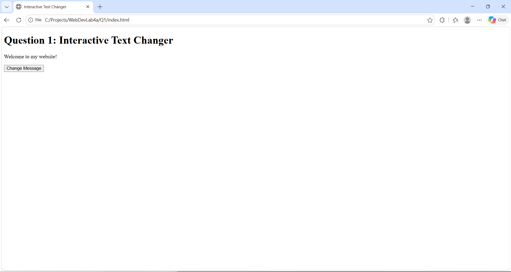
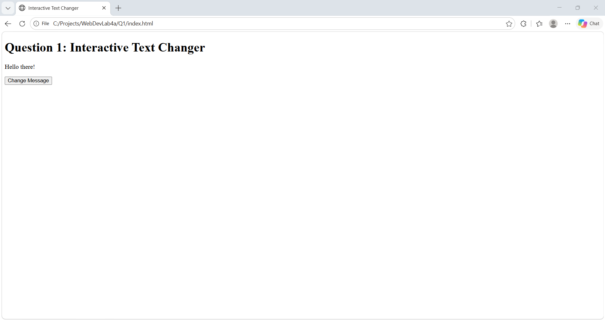
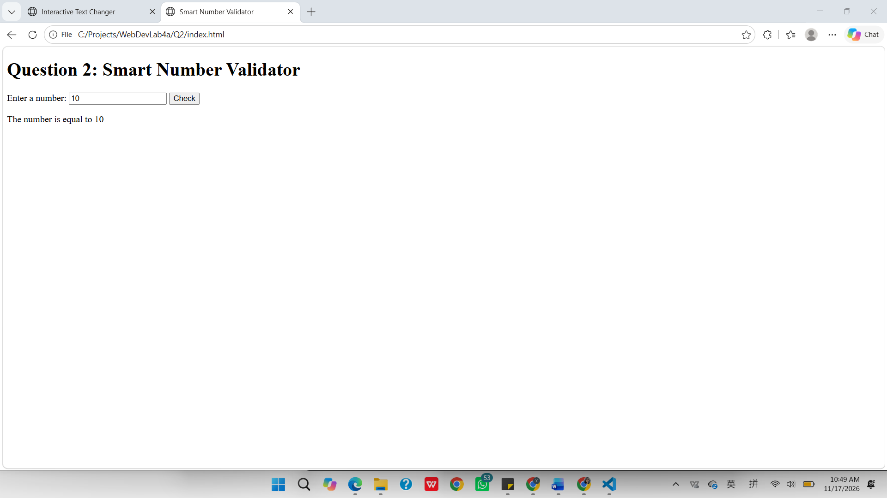
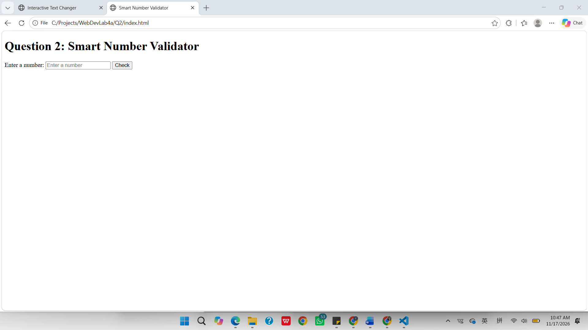
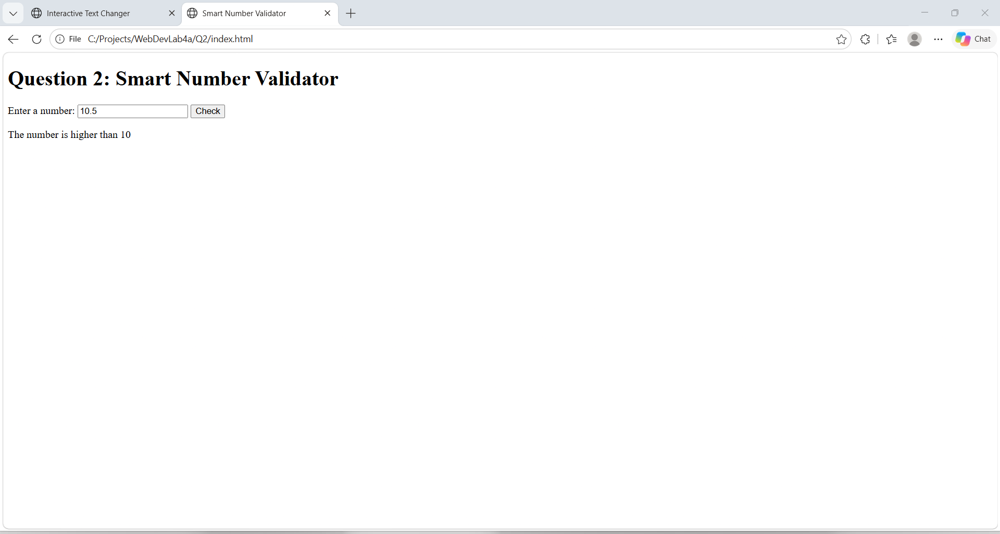
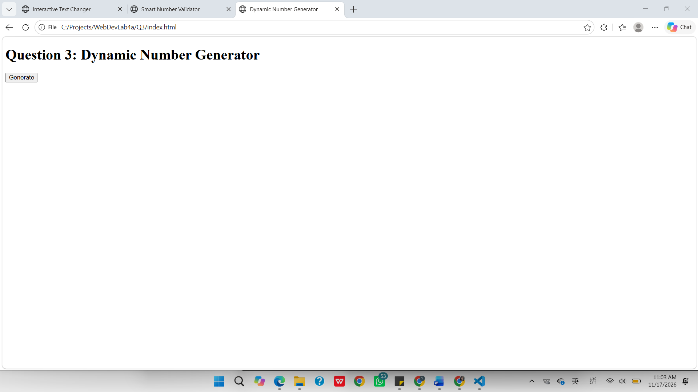
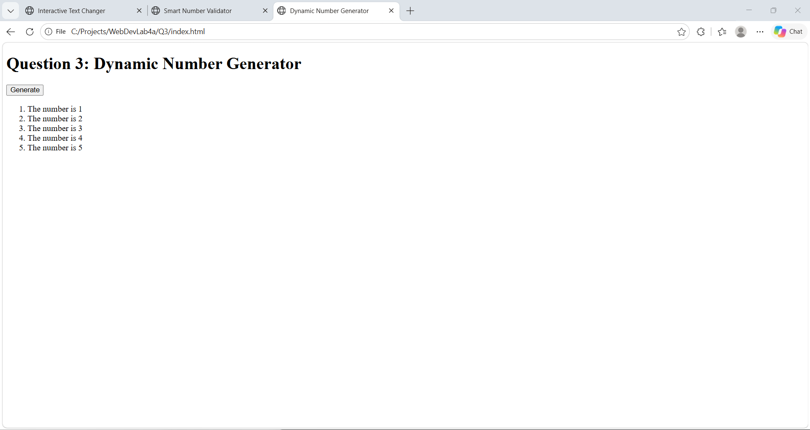

# BIC21203 Web Development – Lab 4a

**Name:** CHEONG YI PING  
**Student ID:** AI240114  
**Lab:** Lab 4a – Client-Side Scripting (JavaScript)

## Description

This lab focuses on JavaScript functions, event handling,
conditions, loops, and DOM manipulation. It consists of
three questions that demonstrate interactive webpages.

## Question 1: Interactive Text Changer

This webpage changes the paragraph text from
"Welcome to my website!" to "Hello there!" when
the Change Message button is clicked.

## Question 2: Smart Number Validator

This webpage allows users to enter a number and
checks whether it is lower than, higher than,
or equal to 10. It also validates empty and
invalid inputs.

## Question 3: Dynamic Number Generator

This webpage uses a for loop to generate numbers
from 1 to 5 when the Generate button is clicked.
It clears previous list items to prevent duplicates.

## How to Run

1. Download or clone this repository.
2. Open the Q1, Q2, or Q3 folder.
3. Open the index.html file in a web browser.
4. Click the buttons to test the JavaScript functions.

## Screenshots

### Question 1: Interactive Text Changer

**Before Clicking the Button**

**After Clicking the Button**

### Question 2: Smart Number Validator

**Input: 5 (Lower than 10)**

**Input: 10 (Equal to 10)**

**Input: 15 (Higher than 10)**

**Input: abc (Invalid Input)**

**Empty Input**

**Input: 10.5 (Decimal Number)**

### Question 3: Dynamic Number Generator

**Before Clicking Generate**

**After Clicking Generate**

